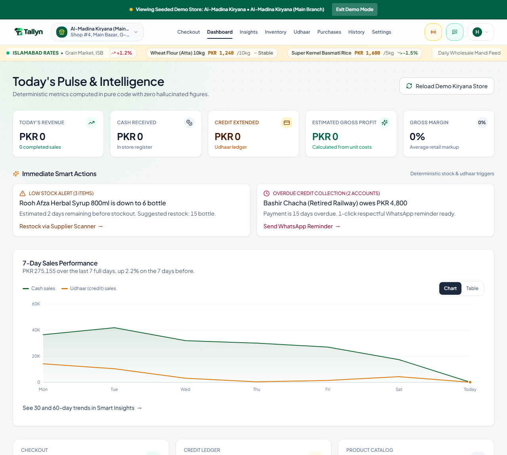
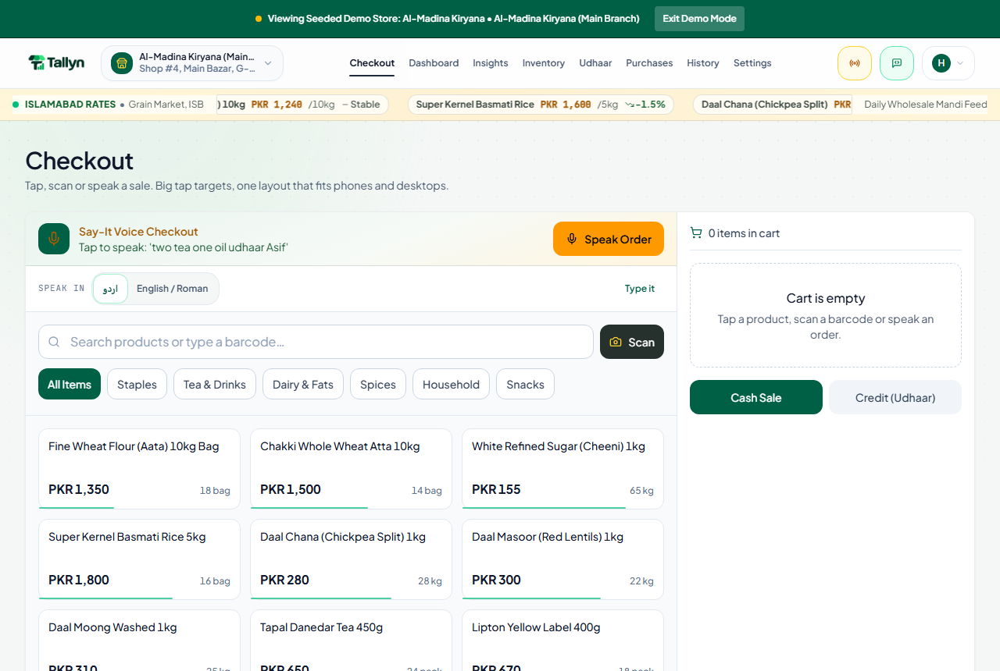
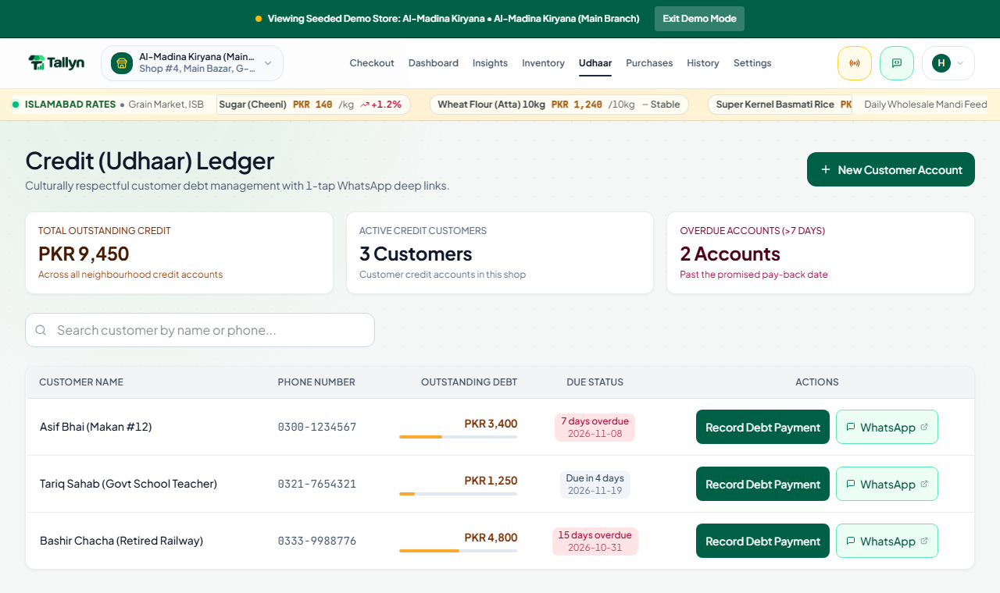
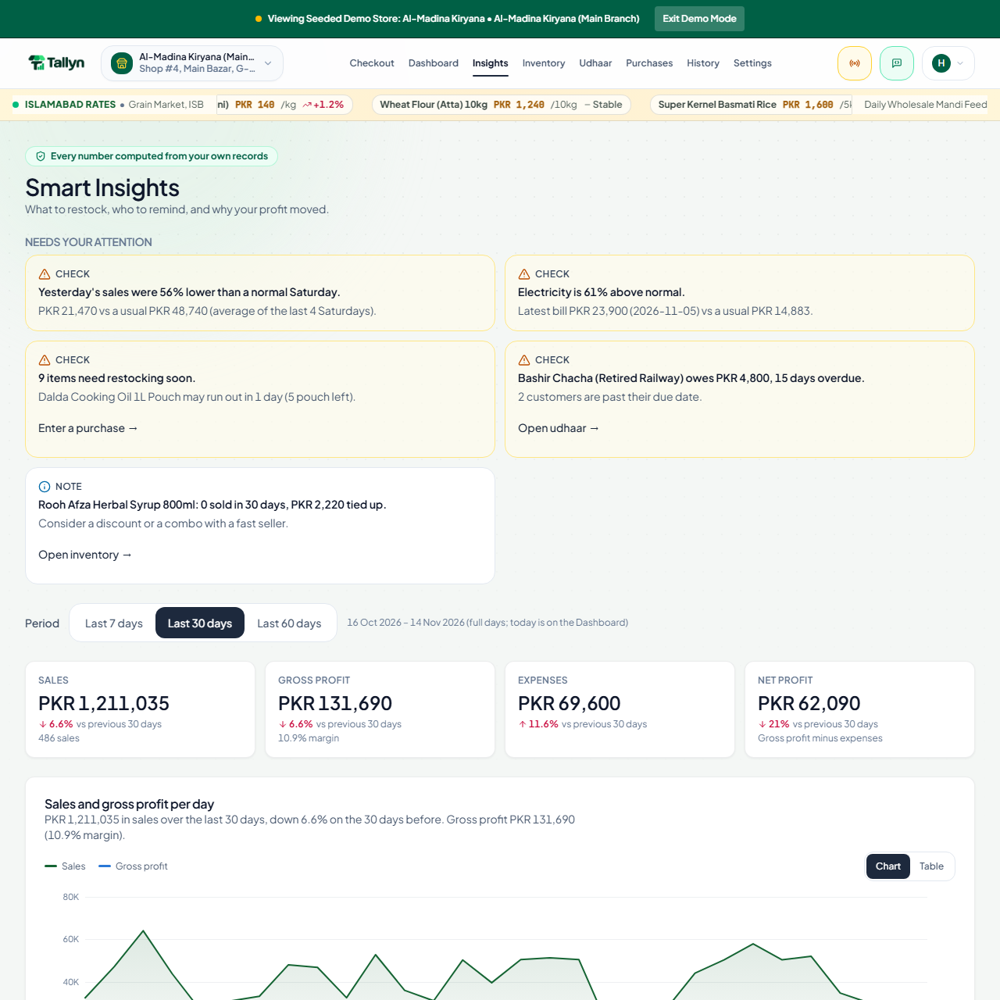
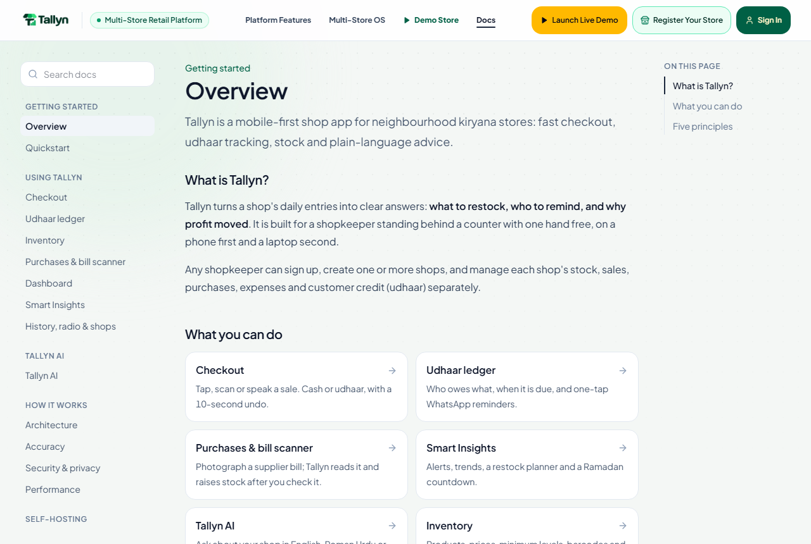
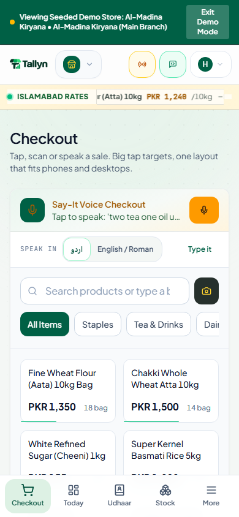
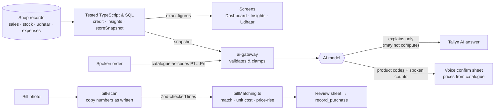
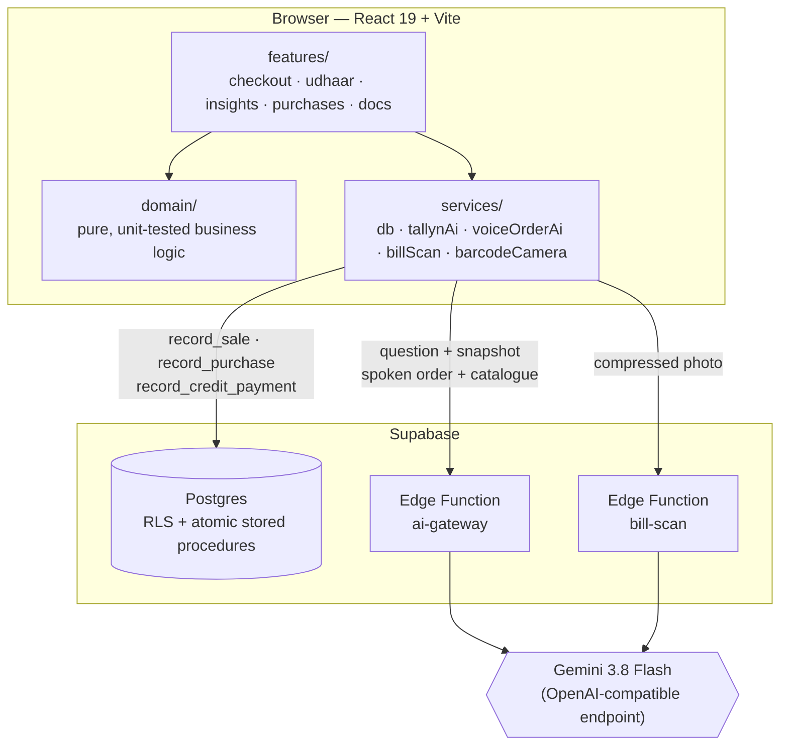
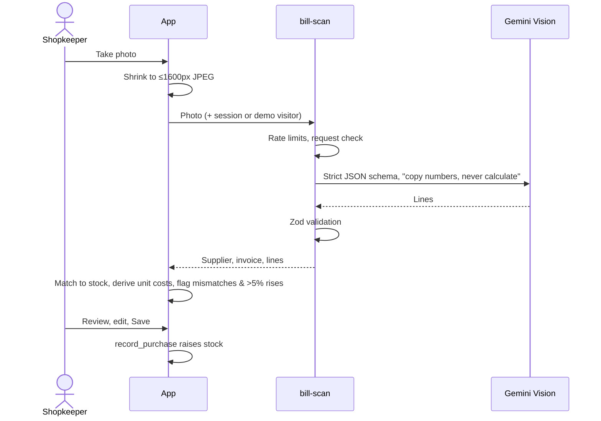

<div align="center">


### Zero-typing checkout, honest numbers and udhaar tracking for neighbourhood kiryana stores

**Tap, scan or speak a sale. Photograph a supplier bill. Know what to restock, who to remind, and why profit moved.**

[**Live demo**](https://tallyn.xyz) · [**Documentation**](https://tallyn.xyz/docs) · [Quickstart](#-quickstart) · [Architecture](#-architecture)


<br />



</div>

---

## Contents

- [Why Tallyn](#-why-tallyn)
- [Features](#-features)
- [How the numbers stay honest](#-how-the-numbers-stay-honest)
- [Architecture](#-architecture)
- [Quickstart](#-quickstart)
- [Self-hosting](#-self-hosting)
- [Project structure](#-project-structure)
- [Testing](#-testing)
- [Status](#-status)
- [Built with](#-built-with)

---

## 💡 Why Tallyn

Small shops have their cash tied up in stock. They lose sales when items run out, overbuy slow products, forget who owes them, and can't say what a day really earned. Most apps *record* transactions; few tell the owner **what to do next**.

Tallyn is built for a shopkeeper standing behind a counter with one hand free — phone first, laptop second — and follows five rules:

| Rule | In practice |
|---|---|
| 🔢 **Zero hallucinated numbers** | Every amount, balance, profit and "days left" is computed by tested code. The AI reads bills, matches spoken orders to your products and explains figures it is given — it never calculates them. |
| ⚛️ **Atomic changes** | Sales, purchases and payments are single database transactions with row locks. |
| 🔒 **Your shop only** | Postgres row-level security plus ownership checks in every stored procedure. |
| 👆 **Counter first** | 44 px+ tap targets, high contrast, aligned money columns, minimal taps. |
| 🛟 **Keeps working** | If the AI is slow or down, checkout, udhaar and stock carry on normally. |

---

## ✨ Features

<table>
<tr>
<td width="50%" valign="top">

### 🛒 Checkout
Tap products, **scan barcodes with the phone camera** (native `BarcodeDetector`, ZXing fallback), use a **USB/Bluetooth scanner**, or **speak the order** in Urdu or English. **Gemini maps what you said onto your own catalogue**, so misheard words like "roof afza" or "lifeboy" still land on the right product; prices always come from the catalogue and you confirm before anything reaches the cart. If the AI is offline, an on-device matcher answers instead. Cash or udhaar with a pay-back date; a 10-second undo.

</td>
<td width="50%">

</td>
</tr>
<tr>
<td width="50%" valign="top">

### 📒 Udhaar ledger
Balances are **credit sales − payments**, never typed in. Each sale has its own due date; payments clear the oldest udhaar first; overpayments are refused. One tap opens a polite **WhatsApp reminder in Urdu-friendly English**.

</td>
<td width="50%">

</td>
</tr>
<tr>
<td width="50%" valign="top">

### 📊 Smart Insights
Alerts (sales drop vs the same weekday, bill spikes, dead stock and the money tied up, expiry, low stock, overdue udhaar), a 7/30/60-day filter, profit tiles, an **interactive sales & profit chart**, a sortable **restock planner** using your supplier lead time, best/slowest sellers, expenses and a **Ramadan countdown**.

</td>
<td width="50%">

</td>
</tr>
<tr>
<td width="50%" valign="top">

### 🧾 Supplier bill scanner
Photograph a bill or parchi → **Gemini Vision** copies the lines → code matches them to your stock, derives unit costs and flags **cost rises over 5%** with a margin-keeping price → you review and save. Nothing is written until you tap Save.

### 🤖 Tallyn AI
Ask in **English, Roman Urdu or Urdu** about your shop, how to use Tallyn, or running the business: what to stock before Ramadan or Eid, pricing, suppliers, collecting udhaar. Figures about your shop are only quoted as the app computed them, and festival dates come from a calendar in code. Requests unrelated to business are politely declined.

### 📻 Kiryana Radio
A spoken daily briefing in **English or easy Urdu**, with a highlighted transcript and one AI tip of the day. The numbers are read from your store data, not the AI.

</td>
<td width="50%">

<p align="center"><sub>Built-in documentation at <code>/docs</code></sub></p>
</td>
</tr>
</table>

<div align="center">

<br /><sub>Designed at 390 px for one-handed counter use</sub>
</div>

---

## 🧮 How the numbers stay honest



| Figure | Calculation |
|---|---|
| Gross profit | sales − Σ(buying cost at time of sale × qty) |
| Udhaar balance | credit sales − payments (oldest sale cleared first) |
| Overdue days | today − earliest unpaid due date |
| Sells per day | units sold in the last 14 days ÷ 14 |
| Reorder qty | ⌈sells/day × (lead time + 3) − stock⌉, min 0 |

---

## 🏗️ Architecture



<details>
<summary><b>What happens when a sale is recorded</b></summary>

```mermaid
sequenceDiagram
    actor S as Shopkeeper
    participant C as Checkout
    participant DB as record_sale (Postgres)
    S->>C: Tap / scan / speak items, choose Cash or Udhaar
    C->>C: Check stock; udhaar needs customer + due date
    C->>DB: shop, items, customer, due date
    DB->>DB: Verify shop owner + customer belongs to shop
    DB->>DB: Lock product rows, check stock
    DB->>DB: Insert sale + items (snapshot unit cost), lower stock
    DB-->>C: sale id (one transaction)
    C->>C: Re-read shop data, show 10-second Undo
    Note over C,DB: Refused → error shown, cart kept.<br/>Network down → saved on device and flagged.
```

</details>

<details>
<summary><b>What happens when a bill is scanned</b></summary>



</details>

| Layer | Choice |
|---|---|
| App | React 19, Vite 6, TypeScript (strict), React Router |
| UI | Tailwind CSS v4, hand-built components, custom SVG charts |
| Data & auth | Supabase Postgres, row-level security, stored procedures, Supabase Auth |
| AI | Supabase Edge Functions (Deno) → Gemini Vision & chat; keys only in server secrets |
| Barcodes | `BarcodeDetector` + ZXing fallback, keyboard-wedge detection for handheld scanners |
| Tests | Vitest (app), Deno test (AI gateway) |

---

## 🚀 Quickstart

```bash
git clone <this-repo> && cd tallyn
npm install
cp .env.example .env          # add your Supabase URL + anon key
npm run dev                    # http://localhost:3000
```

Open the homepage and click **Launch Live Demo** — a three-branch shop with **60 days of generated sales history ending today**, credit customers with due dates, a planted weekday dip and an electricity-bill spike so every insight has something to show. No sign-up needed.

> Full walkthroughs for every screen live in the in-app docs at **`/docs`**.

---

## 🛠️ Self-hosting

1. **Database** — run `supabase/migrations/001` → `007` in the Supabase SQL editor.
2. **Edge Functions** — deploy `supabase/functions/bill-scan` and `supabase/functions/ai-gateway` with **Verify JWT off** (both authenticate callers themselves so demo visitors can use them within limits).
3. **Secrets** — set in Supabase → Edge Functions → Secrets:

   | Secret | Required | Notes |
   |---|---|---|
   | `GEMINI_API_KEY` | ✅ | Key for an OpenAI-compatible Gemini endpoint (we use apinex.bond). Keys starting `AIza` call Google's native Gemini API instead |
   | `GEMINI_MODEL` | | e.g. `free/gemini-3.8-flash` on apinex.bond, or `models/gemini-3.5-flash` on Google |
   | `AI_BASE_URL` | | e.g. `https://api.apinex.bond/v1`; default `https://generativelanguage.googleapis.com/v1beta/openai/` (Google) |
   | `AI_TIMEOUT_MS` | | default `100000` |

4. **Frontend** — `npm run build` and deploy `dist/` (Vercel config included).

> [!WARNING]
> Never put an AI key in a `VITE_` variable — Vite copies those into the public bundle. AI keys belong only in Supabase secrets.

Details: [`supabase/functions/bill-scan/README.md`](supabase/functions/bill-scan/README.md) · [`supabase/functions/ai-gateway/README.md`](supabase/functions/ai-gateway/README.md)

---

## 📁 Project structure

```text
tallyn/
├── src/
│   ├── app/                 # App shell (App.tsx) and routes
│   ├── features/            # One folder per screen
│   │   ├── checkout/        #   Checkout, barcode scanner, voice confirm sheet
│   │   ├── udhaar/          #   Credit ledger
│   │   ├── purchases/       #   Purchases + AI bill scanner sheet
│   │   ├── insights/        #   Smart Insights
│   │   ├── dashboard/       #   Today's pulse, 7-day chart, mandi ticker
│   │   ├── inventory/  history/  settings/  stores/
│   │   ├── assistant/       #   Tallyn AI drawer, Kiryana Radio
│   │   ├── auth/  landing/
│   │   └── docs/            #   /docs site: content, renderers, layout
│   ├── components/          # Shared UI: layout, charts, effects, system pages
│   ├── domain/              # Pure business logic + tests (credit, insights, billMatching, …)
│   ├── services/            # I/O: database, Tallyn AI, bill scan, camera
│   ├── data/                # Demo shop catalogue + 60-day history generator
│   ├── context/             # App state (AppContext)
│   ├── lib/                 # Small helpers (formatting, audio, safe chat markdown)
│   └── types/
├── supabase/
│   ├── migrations/          # 001–007: schema, procedures, RLS, hardening, usage tables
│   └── functions/           # ai-gateway, bill-scan (Deno)
├── docs/screenshots/        # Images used in this README
├── scripts/dev/             # Local connectivity checks
└── public/                  # Logo and icons
```

---

## 🧪 Testing

```bash
npm test                                                       # 125 Vitest tests
npm run build                                                  # strict type-check + production build
deno test --allow-env supabase/functions/ai-gateway/          # prompts, seasons, voice-order checks
```

Covered: profit and period maths, date maths across months and leap years, oldest-first udhaar payments, the reorder planner, every insight rule (including firing on the generated demo history), barcode lookup and scanner detection, ZXing EAN-13 decoding, bill-line matching against a **real model answer**, voice-order validation (unknown products rejected, quantities clamped), the Kiryana Radio script in every language, WhatsApp message text, safe chat rendering, and docs link integrity.

---

## 📌 Status

Built during **IceHacks 2026**. The core shop flows, bill scanner, barcode scanning, Tallyn AI and insights are complete. Not built yet:

- Expense entry form (expenses are seeded in the demo)
- Customer payment-history sheet
- English / Urdu interface toggle (the UI is English; Tallyn AI and voice understand Urdu)
- Installable PWA, end-to-end tests

---

## 🙏 Built with

React · Vite · TypeScript · Tailwind CSS · Supabase · Deno · Gemini · ZXing · Lucide icons · Vitest

AI coding assistants were used during development (Claude Code, Antigravity), with the `nutlope/hallmark` design skill; every change was reviewed, type-checked and tested.
